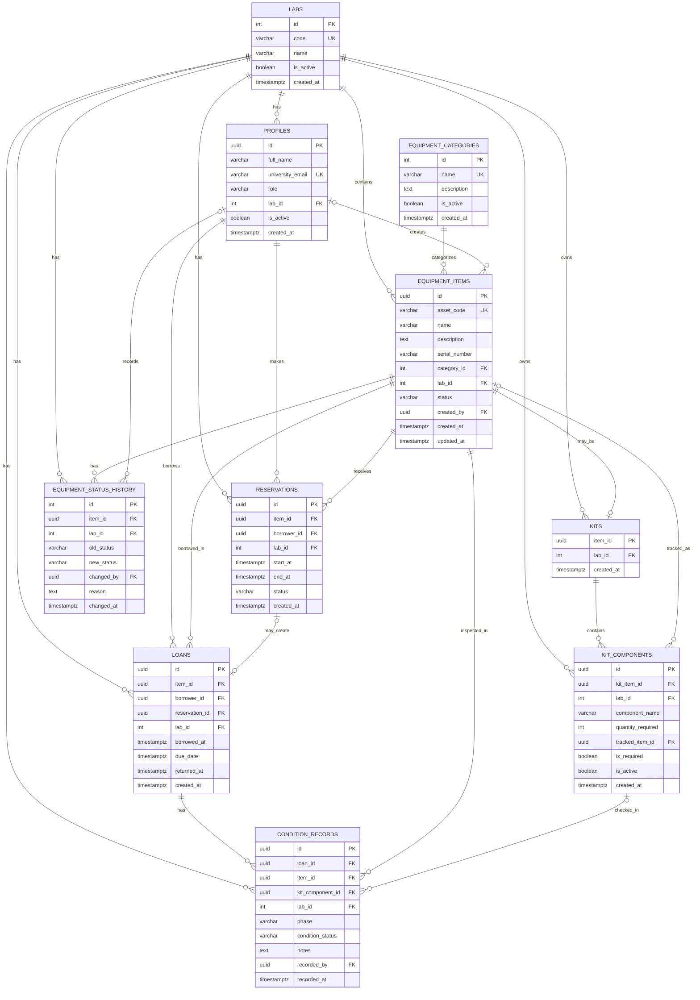

# UniTrack — Entity Relationship Diagram

## Jira S1-04: Design the Data Model

This ERD represents the eight required record types and the supporting laboratory and equipment category tables.

The database uses PostgreSQL hosted on Supabase.

## Complete ERD

## Relationship Explanation

### 1. Labs

One lab can have many users, equipment items, kits, reservations, loans, and historical records.

Each lab-owned record contains a lab ID.

### 2. Equipment Categories

One equipment category can contain many equipment items.

Each equipment item belongs to one category.

### 3. Users

Students and staff are stored in the profiles table.

The role column distinguishes students, lab managers, lab assistants, and administrators.

A user can make multiple reservations and have multiple historical loans.

### 4. Equipment Items

One equipment item can have many reservations, loans, condition records, and status history records.

An equipment item may also represent a kit.

### 5. Kits and Components

A kit is an equipment item with its own asset code and status.

One kit can contain multiple components.

Each component records its name and required quantity.

### 6. Reservations

One item can have multiple reservations for different periods.

A reservation does not automatically change the equipment item's physical status.

A reservation may result in a loan.

### 7. Loans

A loan represents an actual equipment handover.

Each loan belongs to an equipment item and borrower.

The due_date field stores the expected return date.

The returned_at field indicates whether the item has been returned.

An item cannot have two active loans simultaneously.

### 8. Condition Records

A loan can have multiple condition records.

Condition records describe equipment condition during pickup, return, or inspection.

Historical condition records cannot be deleted.

### 9. Equipment Status History

An item can have multiple status history records.

Each record contains the previous status, new status, responsible user, reason, and timestamp.

## Jira S1-04 Requirements

- All eight required record types are represented.
- Item, user, staff, and other lab-owned records contain a lab ID.
- Historical loan and condition records are protected against deletion.
- Future reservations do not automatically change equipment physical status.
